# Labo 13

Zorg dat je de volgende folder structuur volgt:

```
webtechnologie/
├─ labo-01/
│  ├─ oefening-01/
│  │  ├─ index.html
│  │  ├─ images/
│  │  │  ├─ image-1.jpg 
│  │  │  └─ image-n.jpg 
│  │  ├─ css/
│  │  │   ├─ normalize.css
│  │  │   └─ style.css
│  │  └─ js/
│  │     └─ script.js
│  ├─ oefening-02/
│  └─ oefening-n/
├─ labo-02/
└─ labo-n/      
```

- Gebruik steeds JS modules om globale variabelen te vermijden (`<script type="module" src="./path/to/script.js"></script>`)
- Volg de [Coding Guidelines](https://webtechnologie.programmeren-ap.be/coding-guidelines)
- In dit labo vraag je invoer met `prompt()`. De uitleg daarover, samen met `parseInt()` en `isNaN()`, staat bij [Invoer met prompt()](https://webtechnologie.programmeren-ap.be/javascript/basisconcepten/console-en-prompt#invoer-met-prompt)

## Een willekeurig getal met `Math.random()`

In een paar oefeningen heb je een willekeurig getal nodig.

`Math.random()` geeft een willekeurig kommagetal tussen 0 en 1. Nul kan er uitkomen, 1 nooit.

Om daar een geheel getal van te maken tussen een minimum en een maximum (beide inbegrepen), gebruik je:

```js
const randomNumber = Math.floor(Math.random() * (maximum - minimum + 1)) + minimum;
```

`Math.floor()` rondt naar beneden af. Een voorbeeld met een dobbelsteen:

```js
const dice = Math.floor(Math.random() * (6 - 1 + 1)) + 1; // een getal van 1 tot en met 6
```

**Waarom die `+ 1`?** `Math.random() * 6` geeft een getal vanaf 0 tot net onder 6. Na `Math.floor()` hou je 0, 1, 2, 3, 4 of 5 over: zes mogelijkheden. Tel je er `1` bij op, dan krijg je 1 tot en met 6. Zou je `(6 - 1)` schrijven in plaats van `(6 - 1 + 1)`, dan rolt je dobbelsteen nooit een 6.

## Oefening 1: Hello World!

### Leerdoelen

- String interpolatie
- Beslissingen maken (conditionals)

### Functionele analyse

Het programma vraagt een voornaam, achternaam en leeftijd, en toont een welkomstboodschap als de invoer correct is.

### Technische analyse

Schrijf JavaScript dat:

1. Drie waarden vraagt met `prompt()`: voornaam, achternaam en leeftijd. Zet de leeftijd om naar een getal met `parseInt()`.
2. Controleert dat voornaam en achternaam niet leeg zijn. Is er een leeg, toon dan: `Vul zowel voornaam als achternaam in!`
3. Controleert dat de leeftijd een geldig getal is tussen 12 en 60 (grenzen inbegrepen). Is dat niet zo, toon dan: `U behoort niet tot de gezochte leeftijdsklasse!`
4. Is alles in orde, toon dan met string interpolatie: `Welkom <voornaam> <achternaam>, je bent <leeftijd> jaar oud.`
5. Gebruikt `console.log()` voor alle meldingen.

### Voorbeeldinteractie

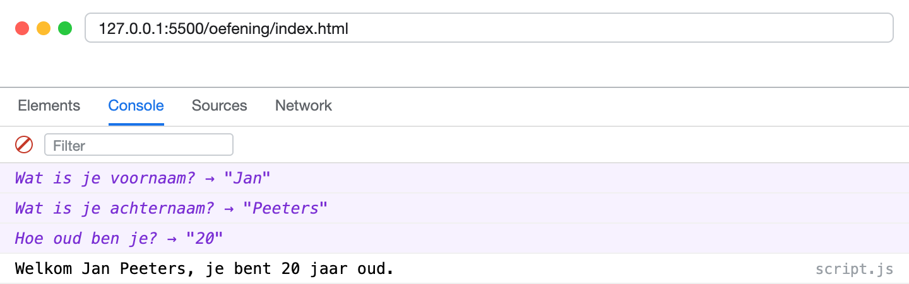

## Oefening 2: Schrikkeljaar

### Leerdoelen

- Beslissingen maken
- Een flowchart omzetten naar code

### Functionele analyse

Het programma vraagt een jaartal en bepaalt of dat een schrikkeljaar is.

### Technische analyse

1. Vraag het jaartal met `prompt()` en zet het om naar een getal met `parseInt()`.
2. Zet onderstaande flowchart om in code. Je hebt er de modulo-operator `%` voor nodig: `jaar % 4` geeft de rest na deling door 4.
3. Toon het resultaat met `console.log()`: `<jaar> is een schrikkeljaar!` of `<jaar> is geen schrikkeljaar.`

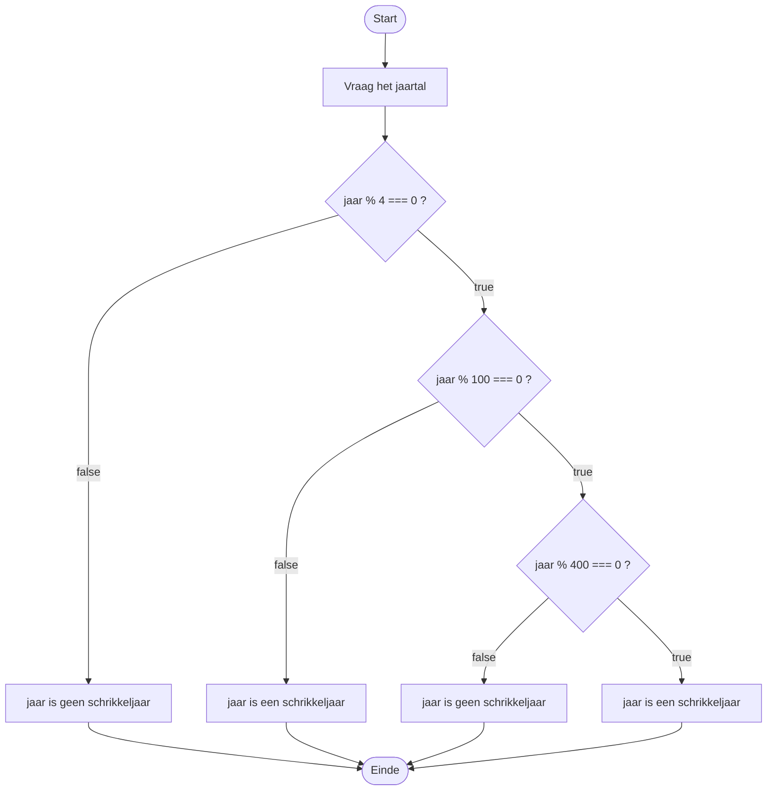

### Voorbeeldinteractie

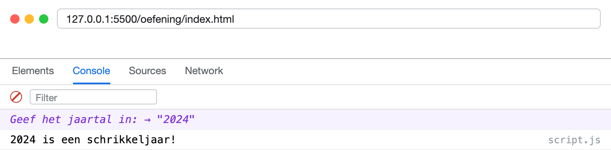

## Oefening 3: Simpele Rekenmachine (if-statements)

### Leerdoelen

- Beslissingen
- Geneste `if`-statements

### Functionele analyse

Het programma voert een eenvoudige berekening uit met twee getallen en een operator (`+`, `-`, `*`, `/`).

### Technische analyse

1. Vraag met `prompt()` twee getallen en zet ze om met `parseInt()`.
2. Vraag met `prompt()` de operator.
3. Controleer eerst of de operator geldig is. Is dat niet zo, toon dan: `Fout: ongeldige operator. Gebruik alleen +, -, * of /.`
4. Controleer daarna, genest in de eerste controle, of er niet door **0** gedeeld wordt. Gebeurt dat wel, toon dan: `Fout: delen door 0 is niet toegestaan.`
5. Gebruik `if`-statements om de juiste berekening uit te voeren en toon het resultaat: `Resultaat: <getal>`

### Voorbeeldinteractie

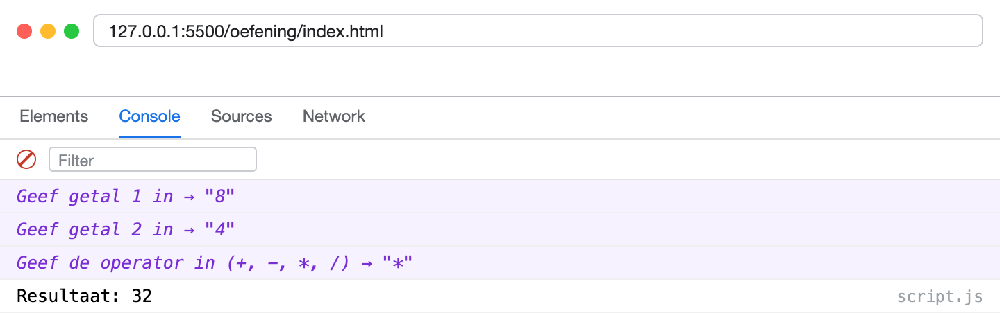

## Oefening 4: Simpele Rekenmachine (switch-case)

### Leerdoelen

- Beslissingen
- Gebruik van `switch`

### Functionele analyse

Zelfde opdracht als oefening 3, maar nu met een `switch`-statement.

### Technische analyse

1. Gebruik een `switch`-constructie voor de operator-keuze, met een `case` per operator.
2. Handel een ongeldige operator af in de `default`-tak van de `switch`. Je hebt dus geen aparte `if` meer nodig om de operator te controleren.
3. Vergeet de `break` niet aan het einde van elke `case`.
4. Controleer, voor je deelt, dat er niet door **0** gedeeld wordt.

### Voorbeeldinteractie

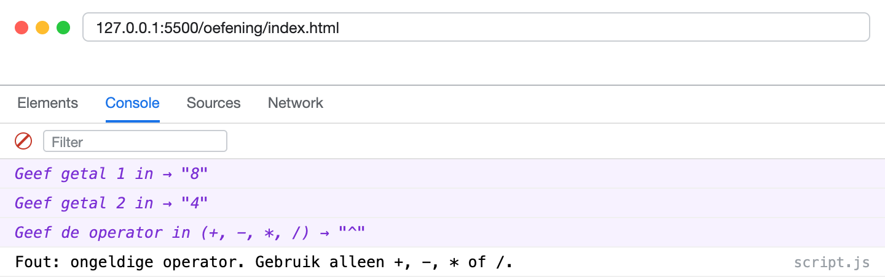

## Oefening 5: Days, Hours and Minutes

### Leerdoelen

- Gebruik van de **modulo-operator**

### Functionele analyse

Het programma berekent welk tijdstip het is nadat je een bepaalde duur optelt bij een startuur.

### Technische analyse

1. Vraag met `prompt()` een **startuur** (0-23) en **startminuten** (0-59), en zet beide om met `parseInt()`.
2. Twee hardgecodeerde variabelen bevatten de uren en minuten die erbij geteld worden.
3. Controleer met `isNaN()` dat beide ingevoerde waarden geldige getallen zijn. Zo niet, toon: `Fout: geef twee geldige getallen in.`
4. Bereken het nieuwe tijdstip:
    - **Komen de minuten op 60 of meer?** → Tel die extra uren erbij.
    - **Komen de uren op 24 of meer?** → Bereken hoeveel dagen erbij komen.
5. Toon eerst het nieuwe tijdstip in de vorm `Nieuw tijdstip: 03:15`, dus met telkens twee cijfers. Een enkel cijfer vul je aan met `String(uur).padStart(2, "0")`.
6. Toon daarna één van deze meldingen:
    - `Dit tijdstip valt nog op dezelfde dag.`
    - `Dit is het tijdstip 1 dag later.`
    - `Dit is het tijdstip <X> dagen later.`
7. Gebruik **modulo (`%`)** en `Math.floor()` voor de berekening.

### Voorbeeldinteractie

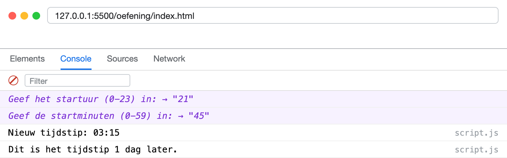

## Oefening 6: Cijfer omzetten naar tekst

### Leerdoelen

- Switch-statements
- Cases groeperen

### Functionele analyse

Een student krijgt een cijfer (0-10). Het programma zet dit cijfer om in een tekstuele beoordeling.

### Technische analyse

- Vraag het cijfer met `prompt()` en zet het om met `parseInt()`.
- Gebruik een switch-statement om het cijfer om te zetten naar:
    - 0-2: `Zeer slecht`
    - 3-4: `Onvoldoende`
    - 5-6: `Voldoende`
    - 7-8: `Goed`
    - 9-10: `Uitstekend`
- Een `case` per cijfer zou tien cases geven. Groepeer daarom de cases die dezelfde code uitvoeren, zoals in het voorbeeld hieronder. Pas onder de laatste `case` van een groep zet je een `break`.

    ```js
    switch (grade) {
        case 0:
        case 1:
        case 2:
            rating = "Zeer slecht";
            break;
        // ...
    }
    ```

- Ligt het cijfer buiten de 0-10, dan toon je in de `default`-tak: `Fout: geef een geldig cijfer tussen 0 en 10.`
- Toon het resultaat in de console.

### Voorbeeldinteractie

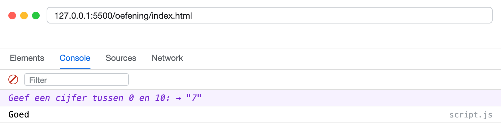

## Oefening 7: Getal raden

### Leerdoelen

- Beslissingen

### Functionele analyse

**Kies** zelf een getal tussen 1 en 10 en sla het op in een variabele `answer`. De gebruiker moet raden welk getal het is.

### Technische analyse

- Sla een zelfgekozen getal tussen 1 en 10 op in een variabele `answer`.
- Vraag de gok van de gebruiker met `prompt()` en zet die om met `parseInt()`.
- Controleer of het getal juist is:
    - Zo ja, toon: `Gefeliciteerd, je hebt het juiste getal geraden!`
    - Zo nee, toon: `Helaas, het juiste getal was <X>.`
- Toon het resultaat in de console.

### Voorbeeldinteractie


## Oefening 8: Willekeurig getal

### Leerdoelen

- Willekeurige getallen

### Functionele analyse

Zelfde spel als oefening 7, maar nu kiest het programma zelf een **willekeurig** getal. Elke keer dat je de pagina herlaadt, is het antwoord anders.

### Technische analyse

- Genereer een willekeurig geheel getal tussen 1 en 10 (beide inbegrepen) en sla het op in `answer`.
- De rest van het programma blijft hetzelfde als in oefening 7.

**Hint**: de formule staat bovenaan bij [Een willekeurig getal met `Math.random()`](#een-willekeurig-getal-met-mathrandom). Zorg dat je ze begrijpt: bekijk wat er gebeurt als `Math.random()` zijn kleinste en grootste mogelijke waarde aanneemt.

### Voorbeeldinteractie

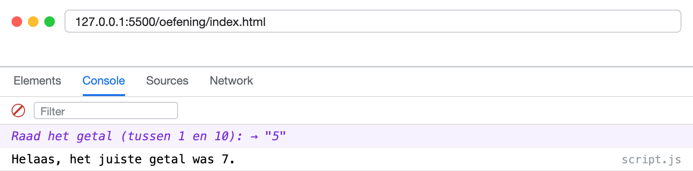

## Oefening 9: Maaltafelgenerator

### Leerdoelen

- Werken met een for-loop
- Wiskundige bewerkingen
- Variabelen declareren met let en const
- Werken met controlestructuren

### Functionele analyse

Je programma genereert op basis van een hardgecodeerde waarde een maaltafelreeks voor een bepaalde maaltafel met een vast aantal iteraties.

### Technische analyse

- Declareer een const genaamd `baseNumber` (het getal dat we telkens gaan vermenigvuldigen) en ken hier een getal aan toe.
- Declareer een const genaamd `numberOfIterations` (de lengte van de maaltafel) en ken hier een getal aan toe.
- Gebruik een stringvariabele om de maaltafel bij te houden.
- Gebruik een for-loop om de maaltafelreeks op te bouwen en voeg elk resultaat toe aan de string, gescheiden door een `", "`.
- Let op dat er achteraan geen komma blijft staan. Je kan die achteraf wegknippen met `substring()`.
- Print de maaltafel uit in de console.

### Voorbeeldinteractie

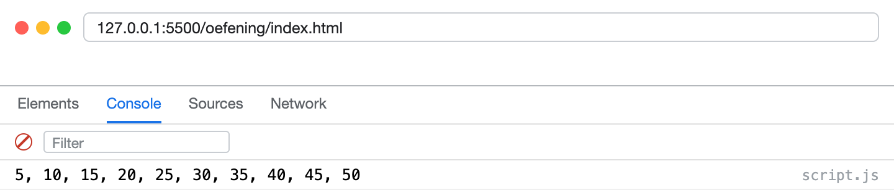

## Oefening 10: Raster Generator

### Leerdoelen

- Werken met een for-loop
- Werken met strings
- Variabelen declareren met let en const

### Functionele analyse

Je programma genereert een raster van kruisjes op basis van hardgecodeerde waarden.

### Technische analyse

- Declareer een const `columns` (kolommen) en ken hier een getal aan toe.
- Declareer een const `rows` (rijen) en ken hier een getal aan toe.
- Gebruik een for-loop om de rijen te doorlopen.
- Gebruik een geneste for-loop om de kolommen te doorlopen.
- Bouw per rij een string met kruisjes (`X`), gescheiden door een spatie, en print elke rij met een `console.log()`.

### Voorbeeldinteractie

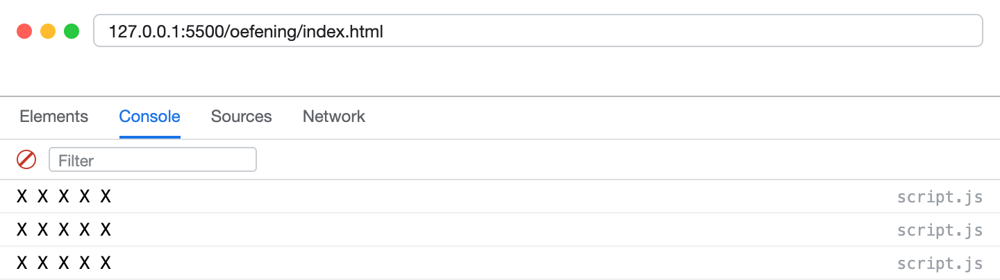

---

## Oefening 11: Raad het Getal

### Leerdoelen

- Werken met een do-while-loop
- Werken met getallen
- Werken met controlestructuren

### Functionele analyse

Het programma laat de gebruiker een getal raden tussen 0 en 30. Zolang de gok fout is, krijgt de gebruiker een hint en wordt er opnieuw gevraagd.

### Technische analyse

- Declareer een const `secretNumber` en ken er een vaste waarde tussen 0 en 30 aan toe.
- Vraag de gok van de gebruiker met `prompt()` en zet die om met `parseInt()`.
- Gebruik een **do-while-loop**: de vraag moet minstens één keer gesteld worden voor je kan controleren, dus hoort de `prompt()` in de body van de lus.
- Geef na elke foute gok aan of het getal hoger of lager moet zijn.
- Stop zodra het juiste getal geraden is en toon: `Gefeliciteerd, je hebt het juiste getal geraden!`

### Voorbeeldinteractie

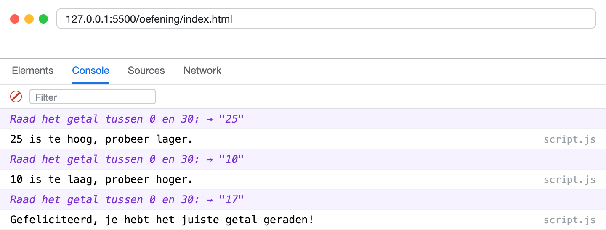

## Oefening 12: Som van Even Getallen

### Leerdoelen

- Werken met een for-loop
- Wiskundige bewerkingen
- Variabelen declareren met let en const

### Functionele analyse

Je programma berekent de som van alle even getallen tot en met een bepaalde hardgecodeerde grens.

### Technische analyse

- Declareer een const `limit` (de grens) en ken hier een getal aan toe.
- Declareer een variabele om de som bij te houden.
- Gebruik een for-loop om door de getallen te itereren.
- Controleer met de modulo-operator of het getal even is en tel het op bij de som.
- Print de uiteindelijke som uit: `De som van alle even getallen tot en met <limit> is <som>.`

### Voorbeeldinteractie

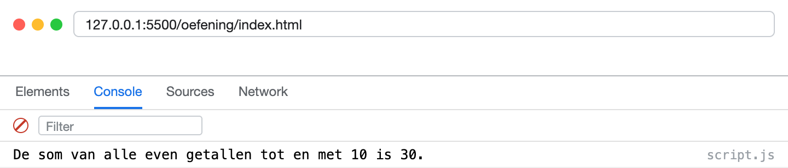

## Oefening 13: Aftellen

### Leerdoelen

- Werken met een while-loop
- Werken met aftellussen
- Variabelen declareren met let en const

### Functionele analyse

Je programma telt af vanaf een hardcoded startwaarde en geeft dan het startschot.

### Technische analyse

- Declareer een const `initialValue` (de startwaarde) en ken hier een getal aan toe.
- Gebruik een while-loop om af te tellen.
- Print bij elke iteratie het huidige getal, van `initialValue` tot en met 1.
- Print na de lus `Start!`.

### Voorbeeldinteractie

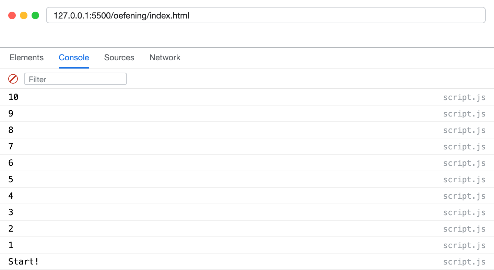

## Oefening 14: Fibonacci-reeks

### Leerdoelen

- Werken met loops
- Werken met strings
- Variabelen declareren met let en const

### Functionele analyse

Je programma genereert de eerste N getallen van de Fibonacci-reeks op basis van een hardcoded waarde. Elk getal in die reeks is de som van de twee vorige: 0, 1, 1, 2, 3, 5, 8, ...

### Technische analyse

- Declareer een const `numberOfGeneratedNumbers` (het aantal te genereren getallen voor het programma stopt) en ken hier een getal aan toe.
- Hou met twee variabelen de twee vorige getallen bij, en start met `0` en `1`.
- Gebruik een loop om telkens het volgende getal te berekenen en voeg het toe aan een stringvariabele, gescheiden door een `", "`.
- Print de reeks uit in de console.

### Voorbeeldinteractie

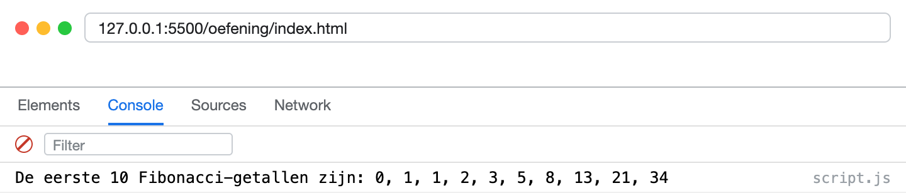

## Oefening 15: Even of oneven (ternaire operator)

### Leerdoelen

- De conditionele (ternaire) operator `? :`
- De NOT-operator `!`
- Werken met een for-loop

### Functionele analyse

Je programma loopt over alle getallen tot een hardgecodeerde grens en zegt van elk getal of het even of oneven is. Op het einde telt het hoeveel oneven getallen er waren.

### Technische analyse

- Declareer een const `limit` en ken hier een getal aan toe.
- Loop met een for-loop van 1 tot en met `limit`.
- Bewaar per getal in een boolean `isEven` of het getal even is. Gebruik daarvoor de modulo-operator en een vergelijking met `===`, dus geen `if`.
- Zet die boolean met de **ternaire operator** om naar tekst, en print `<getal> is even` of `<getal> is oneven`.

    ```js
    const label = isEven ? "even" : "oneven";
    ```

- Hou met een teller bij hoeveel oneven getallen je tegenkomt. Gebruik hiervoor de **NOT-operator**: `if (!isEven)`.
- Print na de lus het totaal. Gebruik opnieuw een ternaire operator om het juiste woord te kiezen, zodat er `Er is 1 oneven getal.` staat bij precies één, en `Er zijn <X> oneven getallen.` bij alle andere aantallen.

### Voorbeeldinteractie

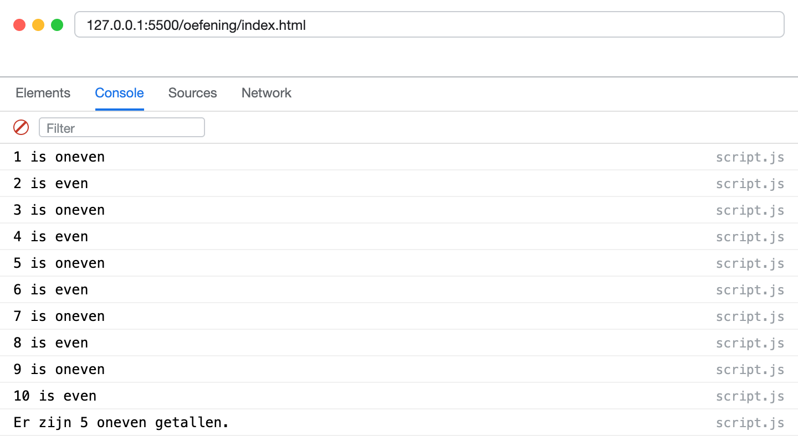
